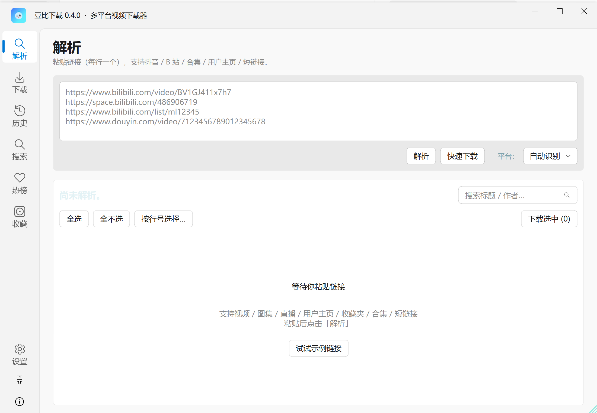

# DouBi 豆比

> 跨平台视频下载器 —— 一个安装包 **74.7 MB** 的 Windows 桌面应用，同时提供 GUI / CLI / REST / MCP 四种形态，下载能力由 [yt-dlp](https://github.com/yt-dlp/yt-dlp) 提供。

<p align="center">
  
</p>

## 亮点

- **轻**：安装包 74.7 MB（0.3.x 时代是 230 MB+）。Chromium 嗅探内核不再捆绑——需要时在「设置 → 功能插件」一键安装，进度条 / 阶段文案 / 安装日志三层实时反馈
- **开箱即用**：N_m3u8DL-CLI 与 ffmpeg 随包分发，HLS 直播与加密流开箱就能下
- **多平台**：抖音、B 站、YouTube 开箱支持；任意视频站走通用嗅探兜底
- **四形态一体**：GUI、CLI（17 个子命令）、REST 服务、MCP 工具共享同一套下载管线，功能一处实现、四端同步获得
- **批量高效**：搜索 / 热榜页表格多选、批量入队；合集 / 合辑整包下载；失败任务一键重试
- **细节到位**：右键直达文件所在文件夹（资源管理器自动选中）、暂停续传、关窗最小化到托盘、下载完成系统通知、7 套主题（含品牌豆比紫 / 深海 / 莫兰迪 / 护眼 / 高对比度）、中英双语
- **自动更新**：启动时静默检查新版本，有新版自动复制 Release 链接（可在设置页关闭）

## 支持平台

| 平台 | 能力 | 说明 |
|---|---|---|
| ✓ 抖音 | 单条 / 图集 / 合集 / 用户作品 / 直播 / 收藏全家桶 | 采集走签名 Web API，下载走 yt-dlp |
| ✓ B 站 | 视频 / 合集 / 收藏夹 / 搜索 / 热榜 / 登录高清 | 收藏夹需先登录；搜索热榜与抖音共用同一套采集参数 |
| ✓ YouTube | watch / shorts / live / youtu.be 短链 | 元数据与下载都走 yt-dlp |
| ✓ 通用视频站 | 任意 URL 嗅探 m3u8 与真视频直链 | 需安装「功能插件」（Chromium 内核）；解析列表只显示视频容器，不会混入 ts 分片 |
| 🚧 计划 | 小红书 / 微博 / 快手 | TikTok 国际版已评估不做，理由见 [docs/ROADMAP.md](docs/ROADMAP.md) |

## 获取

### Windows 用户：直接装（推荐）

到 [Releases](https://github.com/buxiaju/DouBi/releases/latest) 下载 `DouBi-Setup-0.4.3.exe` 双击安装：

- 装到 `%LOCALAPPDATA%\DouBi`，**无 UAC 弹窗**，不需要管理员权限
- 开始菜单 + 桌面快捷方式，控制面板正常卸载，卸载后安装目录零残留（`~/.doubi` 配置默认保留）
- 静默安装：`DouBi-Setup-0.4.3.exe /S /D=D:\DouBi`

**校验完整性**（可选）：Release 资产里附带 `.sha256` 侧签文件，装了 Git 的话一条命令即可：

```bash
sha256sum -c DouBi-Setup-0.4.3.exe.sha256   # 输出 OK 即通过
```

> 0.4.3 的官方哈希：`b6e10e51330453b311eb17ca86b76fb55cba629a59a0fa39263732684b7dd4ec`

**首次使用提示**：想下载抖音 / B 站 / YouTube 之外的任意视频站，先到「设置 → 功能插件」点「安装插件」（约 170 MB 下载，装的是 Chromium 嗅探内核，落在用户目录，不影响安装包体积）。抖音 / B 站登录在设置页「账号与登录」卡里扫码完成。

### 开发者：从源码装

```bash
# 基础内核 + CLI
pip install -e .

# 桌面 GUI（PySide6 Fluent）
pip install -e ".[gui]"

# REST 服务
pip install -e ".[server]"

# 通用嗅探（playwright 客户端；Chromium 内核装 GUI 后在设置页一键安装，或手动 playwright install chromium）
pip install -e ".[sniffer]"

# 全装
pip install -e ".[all]"
```

### 从源码打安装包

```bash
python scripts/build_installer.py        # PyInstaller onedir + NSIS → dist/DouBi-Setup-<version>.exe
python scripts/build_exe.py --onedir     # 仅 PyInstaller，产物 dist/doubi-gui/
python scripts/build_exe.py --with-sniffer  # 回退旧行为：捆绑 Chromium 内核（+400 MB）
```

内置便携版 NSIS（`tools/nsis/`），clone 下来即可打包，不需要额外安装工具。打包全流程、体积核算与踩坑记录见 [docs/BUILD.md](docs/BUILD.md)。

## 四种形态

| 形态 | 入口 | 说明 |
|---|---|---|
| 桌面 GUI | `doubi-gui` | PySide6 Fluent，7 个页面（解析 / 下载 / 历史 / 搜索 / 热榜 / 收藏 / 设置），7 套主题 |
| CLI | `doubi download -u URL` | 17 个子命令，覆盖下载 / 采集 / 登录 / 服务 |
| REST 服务 | `doubi serve` | FastAPI + 内存任务队列（下载 + 采集双端点） |
| MCP 工具 | `doubi-mcp` | stdio JSON-RPC 2.0，9 个工具（解析 / 入队 / 状态 / 搜索 / 热榜等） |

## GUI 功能速览

- **解析页**：贴链接 → 解析 → 结果表右键操作（下载 / 复制链接 / 浏览器打开 / 展开合集 / 查看封面），支持 Ctrl/Shift 多选批量入队
- **下载页**：实时进度 / 总速度统计、暂停续传、失败重试、任务右键「打开所在文件夹 / 打开输出目录」、完成文件缺失检测 + 一键重新下载
- **搜索 / 热榜页**：多平台内容发现、表格多选批量下载、复制链接、浏览器打开
- **收藏页**：抖音收藏夹 / 收藏合集 / 收藏音乐 / 收藏短剧四类管理，右键下钻
- **历史页**：下载记录检索 + 近 7 天平台分布 / 最近下载数 / Top 作者统计条
- **设置页**：输出目录 / 命名模板 / 并发数 / 限速 / 代理、账号登录管理、功能插件一键安装、启动更新检查开关、快捷键速查、诊断包导出

## 项目结构

```
DouBi/
├── pyproject.toml
├── README.md                   # 本文件（项目门面）
├── src/doubi/
│   ├── core/                   # 平台无关内核（models / registry / pipeline / config /
│   │                           #   logger / storage / plugin_manager / update_check）
│   ├── engines/                # 下载引擎适配（yt-dlp / aria2 / nm3u8dl / m3u8 / direct_http）
│   ├── platforms/              # 平台适配器（douyin / bilibili / youtube / ytdlp_generic / generic）
│   ├── cli/                    # 命令行入口（17 子命令）
│   ├── server/                 # REST 服务（FastAPI + JobManager）
│   ├── ui/                     # 桌面 GUI（PySide6 Fluent，7 主题 7 页面）
│   │   ├── pages/              # parse / download / history / search / hot / favorites / settings
│   │   ├── dialogs/            # login / about / sms_verify
│   │   ├── theme.py / i18n.py / task_manager.py / shortcuts.py ...
│   │   └── resources/          # SVG 图标模板 + 主题换色 + 多档位 QIcon
│   └── mcp/                    # MCP 工具（stdio JSON-RPC，9 工具）
├── scripts/                    # build_ico / build_exe / build_installer / run_full_tests
├── installer/doubi.nsi         # NSIS 安装脚本（免 UAC / 中文界面 / 卸载零残留）
├── tools/
│   ├── nsis/                   # 内置便携版 NSIS，clone 下来即可打包
│   └── nm3u8dl/                # N_m3u8DL-CLI + ffmpeg（随安装包分发）
├── screenshots/                # 文档用截图
├── docs/                       # 见下方「文档」表
└── tests/                      # 测试套件（1788+ 用例，offscreen 无头可跑）
```

## 文档

| 文档 | 内容 |
|---|---|
| [docs/QUICKSTART.md](docs/QUICKSTART.md) | 装完之后怎么用：CLI / GUI / REST / MCP、换主题、换语言、解析与下载操作、登录、数据与位置 |
| [docs/USER_GUIDE.md](docs/USER_GUIDE.md) | **面向 Windows 普通用户**：装完到第一次下完的 5 分钟路线图 + 日常高频操作 + FAQ |
| [docs/ARCHITECTURE.md](docs/ARCHITECTURE.md) | 分层、数据流、存储 schema、任务生命周期、主题生效链路、抖音签名采集层 |
| [docs/DEVELOPMENT.md](docs/DEVELOPMENT.md) | 开发约定、各模块要点、主题系统内幕、图标管线、抖音签名栈、测试体系 |
| [docs/CHANGELOG.md](docs/CHANGELOG.md) | 里程碑与缺陷复盘（根因 / 修法 / 判据 / 证据链）—— 按版本号排列 |
| [docs/UI_DESIGN.md](docs/UI_DESIGN.md) | UI 设计语言：视觉原则、7 套主题包配色表、token 与共享组件规范 |
| [docs/ICONS.md](docs/ICONS.md) | 图标管线（SVG 模板 / 主题换色 / 多档位 QIcon） |
| [docs/BUILD.md](docs/BUILD.md) | 打包全流程：体积三层拆解、PyInstaller onedir、NSIS 安装包、实测基线、踩坑记录 |

## 整合来源

- `douyin-downloader-main` —— URL 解析、命名规则、清单文件、Cookie 编排、UI 入口
- `Bili23-Downloader-main` —— 桌面 GUI（Fluent Design）、MCP、命名规则引擎、附加产物（弹幕 / 字幕 / NFO）
- `TikTokDownloader-master` —— 抖音 / TikTok 签名与采集接口参考
- [BiliMusic-Desktop](https://github.com/licpp/BiliMusic-Desktop) —— 数据视图（统计条）、多选批量操作条、应用内检查更新的设计思想来源
- `yt-dlp` —— 实际下载与媒体探测引擎

## 许可

GPL-3.0。详见 `LICENSE`。

## 致谢

- [jiji262/douyin-downloader](https://github.com/jiji262/douyin-downloader)（MIT）
- [ScottSloan/Bili23-Downloader](https://github.com/ScottSloan/Bili23-Downloader)（GPL-3.0）
- [JoeanAmier/TikTokDownloader](https://github.com/JoeanAmier/TikTokDownloader)（MIT）—— 采集接口与签名策略参考
- [licpp/BiliMusic-Desktop](https://github.com/licpp/BiliMusic-Desktop) —— 数据视图与批量交互设计参考
- [yt-dlp/yt-dlp](https://github.com/yt-dlp/yt-dlp)（Unlicense）
