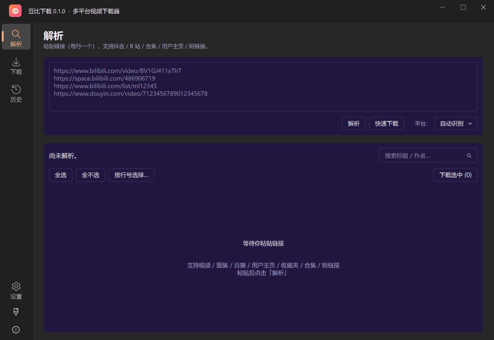

# DouBi

> 跨平台视频下载器内核 —— 一个 GUI + CLI + REST + MCP 多形态统一的多平台下载器，下载能力由 [yt-dlp](https://github.com/yt-dlp/yt-dlp) 提供。

<p align="center">
  
</p>

## 形态

| 形态 | 入口 | 状态 |
|---|---|---|
| 内核（库） | `doubi` | ✓ 平台无关内核 |
| CLI | `doubi download -u URL` | ✓ 17 个子命令，覆盖下载 / 采集 / 登录 / 服务 |
| REST 服务 | `doubi serve` | ✓ FastAPI + 内存任务队列（下载 + 采集双端点） |
| 桌面 GUI | `doubi-gui` | ✓ PySide6 Fluent，7 套主题，6 个页面 |
| MCP 工具 | `doubi-mcp` | ✓ stdio JSON-RPC 2.0，9 个工具 |

四形态覆盖面里程碑：`collect_search` / `collect_hot` 等采集能力**自 0.3.3 起**在 GUI / MCP / REST 三层共用同一套归一化记录结构（实现落在 `cli/main.py`，不是各写一遍）。**0.3.4 进一步扩展到 B 站**——同一个 `platform=douyin|bilibili` 参数走三层。

## 支持平台

- ✓ **抖音**（单条 / 图文 / 合集批量 / 用户作品 / 弹窗链接；**采集**走签名 Web API，下载走 yt-dlp）—— 采集能力见 [docs/QUICKSTART.md](docs/QUICKSTART.md) 的「抖音采集能力」节
- ✓ **B 站**（`Bili23-Downloader` 接入；下载走 yt-dlp；**0.3.4 起**搜索 / 热榜 / 热门视频都走同一套 `platform=` 参数的 `collect_*_async`）
- ✓ **YouTube**（watch / shorts / embed / live / youtu.be 短链；元数据走 yt-dlp `extract_info`，下载走 yt-dlp）
- ✓ **通用视频站**（silidm / sv.baidu.com 等任意 URL：Playwright 启动 Chromium 嗅探 `<video>` 与网络请求，抓出 `m3u8` 与真视频容器后缀的直链；解析列表**只显示视频容器**，不会把 ts/aac 分片混进结果里）
- 🚧 计划：小红书 / 微博 / 快手（TikTok 国际版**已评估不做**，理由见 [docs/ROADMAP.md](docs/ROADMAP.md)）

## 获取

### Windows 用户：直接装

仓库已内置便携版 NSIS，不需要额外安装打包工具，一条命令产出正式安装包：

```bash
python scripts/build_installer.py
```

正式分发有**两种一键运行形态**（不用装 Python，不用 Playwright install）：

| 形态 | 文件 | 体积 | 说明 |
|---|---|---|---|
| **NSIS 安装包**（推荐给普通用户） | `dist/DouBi-Setup-<version>.exe` | 见 Releases 页面 | 双击安装到 `%LOCALAPPDATA%\DouBi`，**无 UAC 弹窗**；开始菜单 + 桌面快捷方式；控制面板正常卸载；**0.3.3 起**卸载后安装目录零残留，`~/.doubi` 配置默认保留 |
| **Onefile 便携版**（推荐给 U 盘 / 网盘） | `dist/doubi-gui.exe` | 见 Releases 页面 | 单文件即跑，启动时自解压到 `%TEMP%/_MEIxxxxx`；免安装；机器之间直接拷。**onefile 更容易被 Windows Defender 误报**（见 [docs/BUILD.md](docs/BUILD.md) §5.5），对外分发优先用安装包 |
| Onedir 绿色目录（内网分发） | `dist/doubi-gui/` | 见 Releases 页面 | **启动最快**；直接 zip 打包即可发布「绿色版」 |

> **体积为什么这么大**：安装包里带了 Playwright Chromium 浏览器目录（通用视频站嗅探的核心依赖）+ PySide6/Fluent 完整样式资源。0.3.0 已经做过一轮精简——onedir 从 1501.8 MB 砍到 678.5 MB（−54.8%：剔掉 QtWebEngine、Qt 多语言翻译、测试与文档目录等，判据见 [docs/BUILD.md](docs/BUILD.md) §4.5）。如果完全不需要通用 Playwright 嗅探（只走 B 站 / 抖音 / YouTube 的 yt-dlp 路径），可以在 `scripts/build_exe.py` 里去掉 ms-playwright 的 `--add-data`，还能再砍一大块。
>
> **卸载残留已清零（0.3.3 修复）**：0.3.0–0.3.2 卸载后会在安装目录里剩一个约 57 KB 的 `doubi.db`——数据库当时是**相对路径**，程序以安装目录为 cwd 启动时就写在那儿，NSIS 删不掉运行期生成的文件。**0.3.3 把 `doubi.db` 与 `download_manifest.jsonl` 的默认路径改到 `~/.doubi/`** 并带静默迁移，安装目录不再产生任何运行期文件，卸载真正零残留。老用户的 `./var/*` 会在首次启动时自动搬到 `~/.doubi/`（目标已存在则不覆盖）。

#### 下载后的 SHA256 校验（推荐做）

每次发布 `dist/` 目录里都会生成侧签文件：`SHA256SUMS.txt` 和
`DouBi-Setup-<version>.exe.sha256`（打了 onefile 便携版时另有
`doubi-gui.exe.sha256`）。内容是标准 `sha256sum` 格式——**哈希后面还跟着一个空格 + `*文件名`**：

```
<hash> *DouBi-Setup-<version>.exe
```

具体某次发布的官方哈希见 **Releases 页面**。Windows PowerShell 一键对比（无需安装任何软件）：

```powershell
# 方式 1：Get-FileHash（推荐）
# 注意 .Split(' ')[0]：侧签行尾带着 " *文件名"，不切开就拿去比必然得到 False
$expected = (Get-Content dist\DouBi-Setup-<version>.exe.sha256).Split(' ')[0].Trim().ToLower()
$actual   = (Get-FileHash dist\DouBi-Setup-<version>.exe -Algorithm SHA256).Hash.ToLower()
$expected -eq $actual    # $true = 通过

# 方式 2：certutil（老 Win 机器也有）
certutil -hashfile dist\DouBi-Setup-<version>.exe SHA256
```

> 装了 Git for Windows / WSL 的话最省事：`sha256sum -c DouBi-Setup-<version>.exe.sha256` 直接输出 `OK`（侧签就是为它准备的格式）。

#### 首次运行「翻译正常」自检 2 条（10 秒确认包是好的）

0.3.0 曾出现过「打包漏加 i18n JSON 导致 GUI 显示英文 key」的 bug，新包到手后跑两条就能确认没回归：

1. **标题栏**：应为「**豆比下载 <version>  ·  多平台视频下载器 - DouBi**」。
   两个容易误判成 bug 的地方，都不是 bug：`·` 两侧各**两个**空格，是 `main_window.py` 那个 f-string 的既有拼法；末尾 `- DouBi` 是 Qt 把 `applicationDisplayName`（`ui/app.py` 里设成 `DouBi`）自动追加到窗口标题上的，源码里没有这一段。如果看到的是 `app.title_suffix` 这种英文 key → 包坏了，换一个新的。
2. **左侧导航**：从上到下应为「**解析 / 下载 / 历史 / 设置**」。如果看到 `nav.parse` / `av.downloads` / `nav.history` / `nav.settings` → 同样是 i18n 资源没打进去。

首次打包（LZMA 压缩 1.5 GB，单线程）耗时约 **3–6 分钟**，详细参数、打包期两条硬规则（DatablockOptimize off + wait_stable 10s）、发布期验证清单见 [docs/BUILD.md](docs/BUILD.md)。

> `.github/workflows/build.yml` **配置上**会在推 `v*` tag 后自动跑测试 + 打包 + 上传安装包并附 SHA256、建一个 draft Release。**但实际情况是：从 0.2.0 到 0.3.1 的 5 次运行全部失败，从未跑到打包段**——runner 只装 `pip install .` 的基础依赖，GUI / REST 测试要的可选包全缺。所以目前每个 Release 都是本地打包 + 手工发布的。另外测试段一红，建 Release 那步会被整段跳过（它没有 `if: always()`），**推了 tag 也不会有 draft Release**，详见 [docs/BUILD.md](docs/BUILD.md) §8.6。

### 开发者：从源码装

```bash
# 1) 基础内核 + CLI
pip install -e .

# 2) 桌面 GUI（PySide6 Fluent）
pip install -e ".[gui]"

# 3) REST 服务
pip install -e ".[server]"

# 4) 全装
pip install -e ".[all]"
```

## GUI 体验提示

几个值得专门提的行为（★ = 0.3.1 新增）：

- ★ **关窗不退出，最小化到系统托盘**：点右上角 × 之后程序仍在后台跑（下载不中断），首次关窗会弹一次提示说明这件事。托盘图标右键四项：显示主窗口 / 全部暂停 / 全部继续 / 退出——真要退出程序走这里
- ★ **下载完成弹系统通知**：设置页「下载完成通知」三档可选，默认是**只在成功时弹**（`success`）；另两档为成功与失败都弹（`all`）、单任务静默、整个队列跑完时弹一次汇总（`summary`）
- ★ **下载前询问支持批量改标题**：勾上「修改视频标题」再填模板，模板里的 `{title}` 会被每个视频自己的标题替换；不写 `{title}` 则所有视频重命名成同一个名字。结果会自动去掉 Windows 非法字符
- ★ **HLS 站点的进度条不再卡在 0%**：走 nm3u8dl 的站点原先整段没有进度反馈，现在有 1Hz 的文件系统 watchdog 兜底，外部工具不吐进度也能看到进度推进
- **窗口默认居中**：启动时落在主屏可用区域的中心（已扣掉任务栏），不会缩在左上角
- **解析列表只显示真视频**：`.m3u8 / .mp4 / .mkv / .flv / .webm / .mov / .avi / .m4v` 才进解析表，HLS 分片（`.ts / .aac / .m4s / .mpd`）全部过滤掉，避免一个视频站页面列出几十条没用的 ts 片段
- **已完成的文件被你手动删了？「重新下载」一键复活**：下载页「已完成」tab 会在刷新时检查磁盘真实文件，缺失的任务会显示「缺失」徽标 + 「文件已删除」文字，右侧按钮变成 **重新下载**（和失败/取消任务的「重试」区分开），点击直接重排进下载队列——不需要再回去解析一遍页面
- **程序异常不会悄无声息闪退**：Qt 槽 / asyncio 任务里未捕获的异常会落完整 traceback 到日志（和默认 stderr），不会直接消失进程

## 项目结构

```
DouBi/
├── pyproject.toml
├── README.md                   # 本文件（项目门面）
├── src/doubi/
│   ├── core/                   # 平台无关内核（models / registry / pipeline / config / logger / storage）
│   ├── engines/                # 下载引擎适配（yt-dlp / aria2 / nm3u8dl / m3u8 / direct_http）
│   ├── platforms/              # 平台适配器（douyin / bilibili / youtube / ytdlp_generic / generic）
│   ├── cli/                    # 命令行入口（17 子命令）
│   ├── server/                 # REST 服务（FastAPI + JobManager）
│   ├── ui/                     # 桌面 GUI（PySide6 Fluent，7 主题）
│   │   ├── app.py              # 入口（--theme / --language）
│   │   ├── main_window.py      # 主窗口 + 路由
│   │   ├── theme.py            # 主题包 + token 表 + set_theme 全局广播
│   │   ├── i18n.py             # JSON 词表 + 模块级 tr()
│   │   ├── locales/            # zh_CN.json / en.json
│   │   ├── resources/          # SVG 图标模板 + 主题换色 + 多档位 QIcon
│   │   ├── widgets.py          # 共享组件（PageHeader / EmptyState / StatChip / ...）
│   │   ├── task_manager.py     # 暂停 / 继续 / 取消
│   │   ├── pages/              # parse / download / history / search / hot / settings
│   │   ├── dialogs/            # login / about / sms_verify
│   │   └── splash.py           # 闪屏
│   └── mcp/                    # MCP 工具（stdio JSON-RPC）
├── scripts/                    # 构建脚本
│   ├── build_ico.py            # SVG → 多尺寸 .ico
│   ├── build_exe.py            # PyInstaller onedir 打包
│   ├── build_installer.py      # 调 NSIS 生成安装程序
│   └── run_full_tests.py       # 全量测试两口径（local / ci）
├── installer/
│   └── doubi.nsi               # NSIS 安装脚本（免 UAC / 中文界面 / 卸载零残留）
├── tools/nsis/                 # 内置便携版 NSIS，clone 下来即可打包
├── screenshots/                # 文档用截图
├── docs/                       # 见下方「文档」表
└── tests/                      # 测试套件（每个里程碑都扩测）
```

> 仓库里不含 `Bili23-Downloader-main/` 与 `douyin-downloader-main/` 这两个被整合的上游源码目录（`.gitignore` 已排除）。它们只是移植时的参考物，运行和构建都不依赖，需要对照时按「整合来源」一节的链接自行下载。

## 文档

| 文档 | 内容 |
|---|---|
| [docs/QUICKSTART.md](docs/QUICKSTART.md) | 装完之后怎么用：CLI / GUI / REST / MCP、换主题、换语言、解析与下载操作、登录、数据与位置 |
| [docs/ARCHITECTURE.md](docs/ARCHITECTURE.md) | 分层、数据流、存储 schema、任务生命周期、主题生效链路、抖音签名采集层 |
| [docs/DEVELOPMENT.md](docs/DEVELOPMENT.md) | 开发约定、各模块要点、主题系统内幕、图标管线、抖音签名栈、测试体系 |
| [docs/CHANGELOG.md](docs/CHANGELOG.md) | 里程碑与缺陷复盘（根因 / 修法 / 判据 / 证据链）—— 按版本号排列 |
| [docs/ICONS.md](docs/ICONS.md) | 图标管线（SVG 模板 / 主题换色 / 多档位 QIcon） |
| [docs/UI_DESIGN.md](docs/UI_DESIGN.md) | UI 设计语言：5 条视觉原则、7 套主题包配色表、token 与共享组件规范 |
| [docs/BUILD.md](docs/BUILD.md) | 打包全流程：`.ico` 生成、PyInstaller onedir、NSIS 安装包、CI 状态、踩坑记录 |

## 整合来源

- `douyin-downloader-main` —— URL 解析、命名规则、清单文件、Cookie 编排、UI 入口
- `Bili23-Downloader-main` —— 桌面 GUI（Fluent Design）、MCP、命名规则引擎、附加产物（弹幕 / 字幕 / NFO）
- `TikTokDownloader-master` —— 抖音 / TikTok 签名与采集接口参考（M6.48–M6.59 的验证基准）
- `yt-dlp` —— 实际下载与媒体探测引擎

## 许可

GPL-3.0。详见 `LICENSE`。

## 致谢

- [jiji262/douyin-downloader](https://github.com/jiji262/douyin-downloader)（MIT）
- [ScottSloan/Bili23-Downloader](https://github.com/ScottSloan/Bili23-Downloader)（GPL-3.0）
- [JoeanAmier/TikTokDownloader](https://github.com/JoeanAmier/TikTokDownloader)（MIT）—— 采集接口与签名策略参考
- [yt-dlp/yt-dlp](https://github.com/yt-dlp/yt-dlp)（Unlicense）